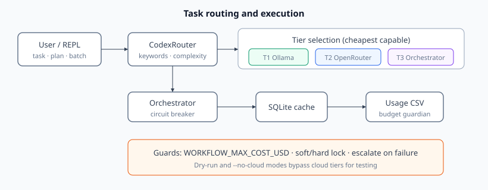
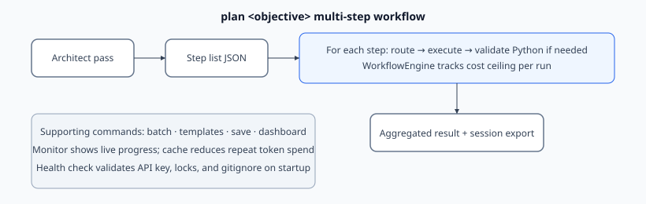

# AI 3-Layer Coder

## Business case

Independent builders and small engineering teams increasingly depend on coding agents, yet **every prompt sent to a frontier model is a recurring operating cost**—and routing everything to the cloud also weakens privacy for proprietary code. Most setups are binary: “local only” (limited quality) or “always premium” (unpredictable spend).

This product exists to **run a disciplined three-tier model**: cheap local inference for routine work, a mid-cost cloud tier when capability is needed, and premium orchestration only when the task demands it. Budget locks, usage accounting, and caching make cost **a first-class operational constraint**, not a monthly surprise. **Intent:** offer a reference implementation partners can inspect for **cost-aware agent infrastructure** on a single workstation—not a hosted IDE, but the routing and guardrails layer underneath one.

**Stack:** Python 3.11+, Ollama, OpenRouter, SQLite cache, Streamlit dashboard  
**License:** [MIT](LICENSE)  
**Topics:** `ollama` · `openrouter` · `ai-agents` · `developer-tools` · `cost-optimization`

---

## Overview

This repository implements a **three-tier routing policy** with production-minded guardrails: circuit breaker on local failures, response cache with tier-specific TTL, CSV usage analytics, soft/hard budget locks, and optional multi-step `plan` workflows. Partners evaluating the author’s agent/tooling work should read the workflow diagrams first, then run the REPL with `--dry-run` to see routing without spending tokens.

## System workflows

### Task routing and execution

<p align="center">
  
</p>

### `plan` multi-step workflows

<p align="center">
  
</p>

## Capabilities at a glance

| Area | What you get |
|------|----------------|
| Routing | Keyword scoring + complexity heuristics pick tier 1/2/3 |
| Reliability | Circuit breaker, stream truncation handling, cache |
| Cost control | Budget guardian locks, per-workflow USD ceiling |
| Operator UX | REPL commands, live monitor, Streamlit dashboard |
| Quality | Detective scan (security/quality/ops), pytest suite |
| Platform | Windows-first autostart & Task Scheduler helpers |

---

## Three tiers

A personal workstation AI coding tool that routes tasks intelligently across three tiers:

```
Local (Ollama / Qwen 2.5 3B)  →  Cloud Heavy (OpenRouter / Qwen 32B)  →  Orchestrator (Claude 3.5 Sonnet)
         free, instant                 ~$0.07/1M tokens                        ~$15/1M tokens
```

The router uses keyword scoring and prompt complexity to pick the cheapest tier that can handle the task. A circuit breaker, response cache, and budget lock system keep costs and failures under control.

---

## Requirements

| Dependency | Version | Notes |
|---|---|---|
| Python | ≥ 3.11 | 3.14 tested |
| [Ollama](https://ollama.ai) | any | Local model server |
| OpenRouter API key | — | Free tier available |
| Windows | 10/11 | For Task Scheduler and autostart scripts |

---

## Quick start

```bash
# 1. Clone / download the project
cd "3 Layer Coder Ecosystem"

# 2. Create and activate a virtual environment
python -m venv .venv
.venv\Scripts\activate

# 3. Install dependencies
pip install -r requirements.txt

# 4. Copy the example env file and fill in your keys
copy .env.example .env
# Edit .env with your OPENROUTER_API_KEY

# 5. Pull the local model (requires Ollama running)
ollama pull qwen2.5-coder:3b

# 6. Run
python codex.py
```

---

## Environment variables (`.env`)

| Variable | Required | Default | Description |
|---|---|---|---|
| `OPENROUTER_API_KEY` | ✅ Yes | — | Your OpenRouter API key |
| `LOCAL_API_URL` | No | `http://localhost:11434/v1/chat/completions` | Ollama endpoint |
| `LOCAL_MODEL_NAME` | No | `qwen2.5-coder:3b` | Ollama model tag |
| `OUTPUT_DIR` | No | current working directory | Where `save <path>` writes files |
| `LOCAL_STREAM_TIMEOUT` | No | `120` | Seconds before a local request times out |
| `BATCH_TASK_TIMEOUT_SEC` | No | `300` | Per-task wall-clock limit in `batch` mode |
| `WORKFLOW_MAX_COST_USD` | No | `5.00` | Max USD spend per `plan` workflow run |

---

## CLI flags

```bash
python codex.py               # normal mode
python codex.py --dry-run     # print routing decisions only — no API calls
python codex.py --no-cloud    # local (Ollama) tier only — no cloud escalation
python codex.py --version     # print version and exit
```

`--dry-run` is useful for testing keyword routing and config without spending any tokens.  
`--no-cloud` is useful on metered connections or when Ollama is the only option.

---

## REPL commands

```
<any text>                  — execute as a task (auto-routed)

plan <objective>            — architect + execute a multi-step workflow
batch <file.txt>            — run tasks line-by-line from a text file
save <path>                 — save last response to a file

save-template <name> <text> — save a reusable prompt template ({placeholder} syntax)
template <name> [key=value] — expand and run a template
templates                   — list all saved templates
del-template <name>         — delete a template

status                      — re-run health check
stats                       — show session statistics (tokens, cost, by model/tier)
cache                       — show response cache stats and hit rate
cache clear                 — wipe the response cache
archive                     — compress old archives, purge 2yr+ files
export                      — export session to JSON
dashboard                   — open analytics dashboard in browser
unlock                      — remove hard/soft budget lock
help                        — show this menu
exit                        — quit
```

---

## Architecture

```
codex.py          — REPL entry point, arg parsing, shutdown
commands.py       — all REPL command handlers, dispatch table
orchestrator.py   — CodexRouter (keyword scoring) + Orchestrator (execution)
task_executor.py  — save_file, validate_python, WorkflowEngine
cache.py          — SQLite response cache with per-tier TTL
codex_logger.py   — CSV usage log writer (MCP tool: record_usage)
session_stats.py  — cost calculation, provider inference, session aggregates
health.py         — startup checks: API key, budget locks, gitignore, reset schedule
budget_guardian.py — background process: watches CSV spend, applies lock files
monitor.py        — live terminal display of current task progress
dashboard.py      — Streamlit analytics dashboard
codex_detective.py — daily security/quality/bug/ops scan → detective_log.jsonl
codex_monthly_reset.py — archive, compress, purge monthly log
config.py         — all paths and constants (single source of truth)
```

**Data flow for a single task:**

```
User input → CodexRouter.route_request()
           → _budget_gate()          # check lock files
           → _is_local_circuit_open()
           → _check_cache()          # SQLite hit?
           → _pre_flight_check()     # cost estimate + optional confirm
           → _run_local_stream() or _run_cloud_stream()
           → response_cache.put()
           → codex_logger.log_task() → model_usage_YYYY.csv
           → _monitor_idle()
```

---

## Budget management

Spend is tracked per-task in `~/codex_futura/analytics/model_usage_YYYY.csv`.

The `budget_guardian.py` daemon watches the CSV every 5 minutes:

- At **80% of `BUDGET_LIMIT_CLP`** → creates `budget_soft.lock` → Orchestrator tier blocked
- At **100%** → creates `budget.lock` → all cloud tasks blocked

Remove locks manually with `unlock` in the REPL or via the Dashboard.

Default limit: **$50,000 CLP** (~$54 USD at the default exchange rate). Override in `config.py`.

---

## Automated tasks (Windows Task Scheduler)

```bash
# Monthly reset (1st of month, 02:00)
python setup_scheduler.py

# Daily detective scan (every day, 08:00)
python setup_scheduler.py --detective

# Verify scheduled tasks
python setup_scheduler.py --status

# Remove all scheduled tasks
python setup_scheduler.py --remove
```

---

## Autostart (monitor on login)

```bash
python setup_autostart.py           # install
python setup_autostart.py --verify  # check paths are still valid
python setup_autostart.py --remove  # uninstall
```

If you move the project folder or upgrade Python, re-run `--remove` then install again.

---

## Running tests

```bash
python -m pytest tests/ -q                     # all tests
python -m pytest tests/ --cov=. --cov-report=term-missing   # with coverage
python -m pytest tests/ -k "circuit"           # filter by keyword
```

Current suite: **267 tests**, 1 skipped (platform symlink).

---

## Running the detective

```bash
python codex_detective.py           # full scan + append to detective_log.jsonl
python codex_detective.py --summary # print last scan without re-running
python codex_detective.py --clear   # wipe the log
```

The detective runs four inspectors: SecurityAuditor, CodeQualityInspector, BugHunter, OperationalMonitor. Findings are shown in the Dashboard under **🕵️ Detective Report**.

---

## Version

Current: **1.0.0**  
See `__version__.py` to bump before tagging a release.

---

## Related portfolio repositories

| Repository | Focus |
|------------|--------|
| [fhir-interop-hub](https://github.com/hfuenzalida/fhir-interop-hub) | Healthcare · FHIR R4 · SMART |
| [rag-retail-analyst](https://github.com/hfuenzalida/rag-retail-analyst) | Sovereign RAG · retail analytics |
| [security-suite-orchestrator](https://github.com/hfuenzalida/security-suite-orchestrator) | DevSecOps · SARIF |
| [digital-brain](https://github.com/hfuenzalida/digital-brain) | Founder business OS |
| [ig-video-to-text](https://github.com/hfuenzalida/ig-video-to-text) | Local video → structured text |
